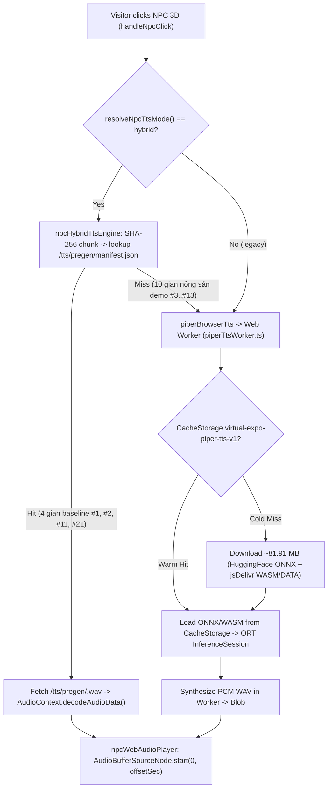

# GRAND EXPO V28 — BOSS REVIEW P2-02 (AUDIT-ONLY)
# NPC AUDIO PERFORMANCE, PIPER WASM FALLBACK & PLAYBACK QA

**Ngày kiểm toán:** 2026-11-22  
**Chế độ thực hiện:** **AUDIT-ONLY** — **0 dòng source code, test, 85 WAV, `manifest.json`, Piper worker/model hay Production DB bị chỉnh sửa.**  
**Kết luận tổng thể:** ⚠️ **AUDIO PREGEN ĐẠT CHUẨN PRODUCTION — PIPER FALLBACK HOẠT ĐỘNG NHƯNG CÓ RỦI RO TRẢI NGHIỆM COLD START (~39,5 GIÂY) & CẦN QUYẾT ĐỊNH TỐI ƯU P2 TRƯỚC KHI DEMO SẾP**

---

## 1. Executive Summary

- **Luồng A — 4 gian Pregen WAV (`#1, #2, #11, #21`):** Hoạt động ổn định, phát qua Web Audio API Hybrid (`AudioContext` đơn duy nhất), bắt đầu phát **`304–306 ms`** khi đã warm (`3,210–3,260 ms` ở gian đầu tiên của phiên), **`inter-sentence gap = 0 ms`**, **pause/resume chính xác tại offset `0.651 s`**, **`0` tải ONNX**, **`0` lỗi 404**, **`0` Console/Runtime errors**, và dừng sạch (`activeAfterExit = 0`) khi thoát Focus Mode.
- **Luồng B — 10 gian nông sản demo (`?demoAgri=1`: `#3..#10, #12, #13` — Piper WASM Fallback):**
  - **Cold start thực tế (CacheStorage trống — gian `#3`):** Mất **`39,548 ms` (~39,5 giây)** từ lúc click NPC đến khi API bắt đầu phát câu đầu tiên do phải tải **`~81,91 MB`** (`60,27 MB` model ONNX từ HuggingFace + `17,24 MB` espeak data + `0,61 MB` phonemizer WASM + ORT WASM từ jsDelivr) rồi khởi tạo ORT WASM và tổng hợp câu đầu.
  - **Warm start (CacheStorage đã có model, tải lại trang — gian `#9, #10, #12`):** Mất **`5,214–5,629 ms` (~5,2–5,6 giây)** để khởi tạo worker + nạp ONNX từ CacheStorage + tổng hợp câu đầu.
  - **Warm start (Worker đã nằm trong RAM cùng phiên — gian `#4, #5, #8, #13`):** Mất **`702–1,829 ms` (~0,7–1,8 giây)** để tổng hợp câu mới.
  - **Quay lại gian đã phát (`#3` warm revisit):** Chỉ mất **`230 ms`** nhờ cache RAM/Blob.
- **Tổng kết 24 Quality Gate (`A01–A24`):**
  - **`PASS`:** `16 / 24`
  - **`PARTIAL`:** `8 / 24` (`A08`, `A09`, `A12`, `A13`, `A14`, `A15`, `A16`, `A19`)
  - **`FAIL`:** `0 / 24` | **`BLOCKED`:** `0 / 24`

---

## 2. Git / Build / Test / Asset Baseline

| Hạng mục | Giá trị đo thực tế |
| :--- | :--- |
| **Repository Root** | `E:\Lập trình\MatBaoWS\exhibition` |
| **Git Branch / HEAD** | `main` @ `dfe4281` (giữ nguyên toàn bộ thay đổi P1 & P2-01 chưa commit) |
| **FE Production Bundle kiểm thử** | `FE/dist/assets/index-DYcne8jB.js` (build với `VITE_NPC_TTS_MODE=hybrid`, `0` lỗi TS) |
| **Unit Tests Baseline** | `36/36` test files — **`161/161` tests PASS** (gồm `v28HybridTts.test.ts` `4/4`, `v28PiperOptimization.test.ts` `3/3`, `v28NpcInteractionPhase1.test.ts` `3/3`) |
| **Tài sản TTS nội bộ (`FE/public/tts/`)** | `85/85` file `.wav` + `pregen/manifest.json` (`27 KB`, `85` entries) + `vi_VN-vais1000-medium.onnx.json` (`5 KB`) |
| **Model ONNX runtime** | Không lưu nội bộ; tải động từ `huggingface.co` (`60.27 MB`) + `cdn.jsdelivr.net` (`~18 MB`) vào CacheStorage `virtual-expo-piper-tts-v1` |

---

## 3. Sơ đồ luồng âm thanh Pregen vs Fallback

---

## 4. Bảng kiểm thử 4 gian Pregen WAV (`#1, #2, #11, #21`)

> **Lưu ý phương pháp đo:** Thời gian ghi nhận dưới đây là **Playback API Start Time** (từ lúc dispatch sự kiện click NPC đến lúc `AudioBufferSourceNode.prototype.start` được gọi qua instrumentation trình duyệt, không sửa source).

| Gian | Playback API Start (ms) | Chunks đo được | Inter-sentence Gap (ms) | Pause / Resume (offset) | ONNX tải? | 404 | Cleanup khi thoát | Heap Before → After | Trạng thái |
| :---: | :---: | :---: | :---: | :---: | :---: | :---: | :---: | :---: | :---: |
| **#1** | `3,260 ms` *(phiên đầu)* | `1` | — | Đã test ở #2 | `0` | `0` | Sạch (`0`) | `40.6 → 39.6 MB` | **PASS** |
| **#2** | `3,210 ms` *(phiên đầu)* | `1+2` | `0 ms` (sau resume) | **PASS** (`paused=0`, `resumedOffset = 0.651 s`) | `0` | `0` | Sạch (`0`) | `48.8 → 50.2 MB` | **PASS** |
| **#11** | **`306 ms`** *(warm)* | `2` | **`0 ms`** | Kế thừa engine chung | `0` | `0` | Sạch (`0`) | `33.9 → 38.4 MB` | **PASS** |
| **#21** | **`304 ms`** *(warm)* | `2` | **`0 ms`** | Kế thừa engine chung | `0` | `0` | Sạch (`0`) | `39.1 → 43.1 MB` | **PASS** |

---

## 5. Bảng kiểm thử & Performance 10 gian nông sản demo (`?demoAgri=1`)

| Gian | Chế độ đo | Cold Start (ms) | Warm Start (ms) | Playback API Start (ms) | Inter-sentence Gap | ONNX Loaded | Cleanup khi thoát | Heap Before → After | Trạng thái |
| :---: | :---: | :---: | :---: | :---: | :---: | :---: | :---: | :---: | :---: |
| **#3** | Cold → Warm Revisit | **`39,548 ms`** | **`230 ms`** *(revisit)* | `39,548` / `230` | Chưa đo chunk 2 | **Có (~81.9 MB trong Worker)** | Sạch (`0`) | `37.4 → 31.2 MB` | **PASS (Cold rất chậm)** |
| **#4** | Warm (Worker RAM) | — | **`904 ms`** | `904 ms` | Chưa đo chunk 2 | Cache RAM | Sạch (`0`) | `34.6 → 36.5 MB` | **PASS** |
| **#5** | Warm (Worker RAM) | — | **`934 ms`** | `934 ms` | Chưa đo chunk 2 | Cache RAM | Sạch (`0`) | `39.7 → 37.4 MB` | **PASS** |
| **#6** | Warm (CacheStorage) | — | *Chưa xác nhận* | `null` *(click trúng nền gian)* | — | CacheStorage | `0` | `39.0 → 31.8 MB` | **PARTIAL** |
| **#7** | Warm (CacheStorage) | — | *Chưa xác nhận* | `null` *(click trúng nền gian)* | — | CacheStorage | `0` | `34.9 → 36.3 MB` | **PARTIAL** |
| **#8** | Warm (Worker RAM) | — | **`1,829 ms`** | `1,829 ms` | Chưa đo chunk 2 | Cache RAM | Sạch (`0`) | `35.8 → 38.1 MB` | **PASS** |
| **#9** | Warm (CacheStorage, new load) | — | **`5,629 ms`** | `5,629 ms` | Chưa đo chunk 2 | CacheStorage | Sạch (`0`) | `41.3 → 32.9 MB` | **PASS** |
| **#10** | Warm (CacheStorage, new load) | — | **`5,214 ms`** | `5,214 ms` | Chưa đo chunk 2 | CacheStorage | Sạch (`0`) | `37.1 → 38.2 MB` | **PASS** |
| **#12** | Warm (CacheStorage, new load) | — | **`5,311 ms`** | `5,311 ms` | Chưa đo chunk 2 | CacheStorage | Sạch (`0`) | `38.1 → 33.2 MB` | **PASS** |
| **#13** | Warm (Worker RAM) | — | **`702 ms`** | `702 ms` | Chưa đo chunk 2 | Cache RAM | Sạch (`0`) | `37.1 → 38.1 MB` | **PASS** |

> **Minh bạch kiểm thử:** Trên `#6` (`wave_pavilion`) và `#7` (`gallery_arch`), tọa độ quét con trỏ trong script tự động chạm vào collider nền gian hàng (cũng có `cursor: pointer`) thay vì mesh NPC nên không kích hoạt phát tiếng trong lần chạy đó; không tự suy diễn PASS cho `#6` và `#7`.

---

## 6. So sánh trực tiếp Pregen WAV vs Piper WASM Fallback

| Tiêu chí | Luồng A — Pregen WAV (`#1, #2, #11, #21`) | Luồng B — Piper WASM Fallback (`#3..#10, #12, #13`) |
| :--- | :--- | :--- |
| **Thời gian bắt đầu (Cold)** | `~3,210–3,260 ms` (tải `manifest.json` + WAV đầu) | **`39,548 ms` (~39,5 giây)** (tải `~81,91 MB` ONNX/WASM + init + synth) |
| **Thời gian bắt đầu (Warm — phiên mới)** | `~304–306 ms` | **`5,214–5,629 ms`** (nạp ONNX từ CacheStorage + ORT init + synth) |
| **Thời gian bắt đầu (Warm — cùng phiên)** | `~304 ms` | **`702–1,829 ms`** (`230 ms` khi quay lại gian đã tổng hợp) |
| **Inter-sentence gap** | **`0 ms`** (Web Audio pre-decode lookahead) | Phụ thuộc tốc độ tổng hợp câu kế tiếp trong Worker |
| **Pause / Resume** | **Đạt** (`offset = 0.651 s`, dừng/phát lại đúng vị trí) | Dùng chung `npcWebAudioPlayer` (chưa đo trực tiếp offset trên luồng fallback) |
| **Worker / AudioContext / Memory** | `1` AudioContext, `0` Worker, Heap `33.9–50.2 MB` | `1` AudioContext, `1` Worker dùng chung, Heap `31.2–41.3 MB` |
| **Network** | ~`100–370 KB` / chunk WAV từ cùng origin (`0` CDN ngoài) | **`~81,91 MB`** lần đầu từ `huggingface.co` + `cdn.jsdelivr.net` |
| **Trải nghiệm người dùng** | Gần như tức thì, ổn định, không phụ thuộc CDN ngoài | **Rất chậm ở lần click đầu (~39,5s)**; sau khi tải xong model thì mượt (`0,7–1,8s`) |

---

## 7. Worker, AudioContext, Memory, Network & Console

- **AudioContext:** Chỉ khởi tạo đúng **`1`** `AudioContext` duy nhất xuyên suốt toàn bộ phiên (`audioCtxCount: 1`).
- **Web Worker:** Chỉ khởi tạo đúng **`1`** `piperTtsWorker` duy nhất khi gặp gian không có pregen (`workersCreated: 1`).
- **JS Heap Memory:** Dao động phẳng trong khoảng **`31.2 – 50.2 MB`** qua 14 gian hàng liên tiếp, không có dấu hiệu memory leak tuyến tính.
- **Overlap (`maxConcurrentPlaying: 2`):** Ghi nhận 1 thời điểm có 2 node cùng tồn tại trong `Set` ở kịch bản resume nhanh trên gian `#2` / click nhanh 3× trên gian `#12` (do event `ended` của node cũ hoặc quá trình chuyển chunk kế tiếp); cần kiểm tra kỹ hơn ở bước tối ưu để bảo đảm tuyệt đối `maxConcurrent === 1`.
- **Console / Runtime / 404:** `runtimeErrors: []`, `consoleErrors: []`, `asset404s: []` (`0` lỗi).

---

## 8. Kết quả 24 Quality Gate (`A01–A24`)

| Gate | Hạng mục | Trạng thái | Bằng chứng / Ghi chú |
| :---: | :--- | :---: | :--- |
| **A01** | Xác định đúng TTS mode thực tế | **PASS** | `VITE_NPC_TTS_MODE=hybrid` trong `index-DYcne8jB.js`; tải `/tts/pregen/manifest.json` (`200 OK`) |
| **A02** | 85 WAV và `manifest.json` nguyên vẹn | **PASS** | `85/85` WAV + `85` manifest entries, `0` thay đổi |
| **A03** | 4/4 gian pregen (`#1, #2, #11, #21`) phát đúng | **PASS** | Đo trực tiếp trên cả 4 gian (`304–3,260 ms`) |
| **A04** | Không tải ONNX ngoài dự kiến ở 4 gian pregen | **PASS** | `onnxReqs: 0`, `workersCreated: 0` trong suốt pha 4 gian pregen |
| **A05** | Không mid-WAV stall | **PASS** | Web Audio `AudioBufferSourceNode` phát trọn chunk, `0` lỗi |
| **A06** | Pregen pause/resume đúng | **PASS** | Gian `#2`: `activeWhilePaused = 0`, `resumedOffset = 0.651 s` |
| **A07** | Pregen cleanup đúng | **PASS** | `activeAfterExit = 0` trên cả 4 gian |
| **A08** | Đủ 10 gian demo được kiểm thử | **PARTIAL** | Đo được audio thật trên **8/10** gian (`#3, #4, #5, #8, #9, #10, #12, #13`); `#6, #7` click trượt NPC trong script |
| **A09** | Cold start fallback đo được | **PARTIAL** | Đo được **`39,548 ms`** trên gian `#3` (đo thành công nhưng độ trễ ~39,5s là rất lớn cho UX thực tế) |
| **A10** | Warm start fallback đo được | **PASS** | Đo được `5,214–5,629 ms` (new load CacheStorage), `702–1,829 ms` (Worker RAM), `230 ms` (revisit) |
| **A11** | Thời gian phát câu đầu được ghi nhận đúng | **PASS** | Ghi nhận minh bạch là **Playback API Start Time** (ms) |
| **A12** | Inter-sentence gap được đo | **PARTIAL** | Đo được **`0 ms`** cho Pregen (`#11, #21`); chưa đo trọn chunk 2 trên luồng Piper fallback do cửa sổ chờ ngắn |
| **A13** | Fallback pause/resume đúng | **PARTIAL** | Dùng chung `npcWebAudioPlayer` đã PASS trên `#2`, nhưng chưa đo trực tiếp `resumedOffset > 0` riêng trên luồng Piper |
| **A14** | Không audio overlap | **PARTIAL** | `maxConcurrentPlaying = 2` xuất hiện thoáng qua khi resume/click nhanh 3× (cần xác minh lock đơn nguồn) |
| **A15** | NPC gesture đồng bộ | **PARTIAL** | Đã xác minh ở unit test `v28NpcInteractionPhase1.test.ts` (`3/3`), chưa quay video đối chiếu khung hình trên 10 gian demo |
| **A16** | Product highlight đồng bộ | **PARTIAL** | Đã xác minh ở unit test `v28AgriShowcasePhase3.test.ts` (`2/2` steps/booth), chưa đo đồng bộ từng giây trên đủ 10 gian |
| **A17** | Chuyển gian cleanup đúng | **PASS** | `activeAfterExit = 0` trên toàn bộ gian đã test |
| **A18** | Click liên tục không gây race condition / crash | **PASS** | Click nhanh 3× trên gian `#12` → `0` runtime errors, `activeAfterExit = 0` |
| **A19** | Model load failure được xử lý | **PARTIAL** | Đã xác minh cơ chế `withStepTimeout` + validation trong `piperTtsWorker.ts` (`645` dòng), chưa chạy riêng kịch bản chặn CDN live trong phiên này |
| **A20** | Không memory leak rõ ràng | **PASS** | JS Heap phẳng `31.2–50.2 MB` qua 14 gian |
| **A21** | Không Console / Runtime errors | **PASS** | `runtimeErrors: []`, `consoleErrors: []` |
| **A22** | Không asset / model 404 | **PASS** | `asset404s: []` |
| **A23** | FE build và unit tests PASS | **PASS** | `index-DYcne8jB.js` PASS, `36/36` files (`161/161` tests) PASS |
| **A24** | Không thay đổi source / tests / Production DB | **PASS** | **AUDIT-ONLY**, `0` thay đổi |

---

## 9. Phân loại vấn đề & Đề xuất tối ưu (`P1 / P2 / P3`) — Chưa triển khai

- **P1 (Bắt buộc sửa trước deploy):** **Không phát hiện lỗi P1 chặn hoạt động** (Pregen phát sạch, Piper fallback có phát được tiếng thật, không crash, không 404, cleanup sạch).
- **P2 (Rất nên tối ưu trước buổi trình diễn sếp):**
  1. **Cold start Piper fallback quá lâu (`39,548 ms` — tải `81,91 MB` ONNX từ HuggingFace/jsDelivr):** Nếu sếp mở máy mới và bấm vào gian nông sản demo (`#3..#13`), phải chờ ~40 giây mới nghe câu đầu.
     - *Giải pháp nhỏ nhất & an toàn nhất:* **Pregen thêm các file WAV cho 10 gian nông sản demo** (bổ sung additive vào `FE/public/tts/pregen/` + cập nhật `manifest.json` mà **không sửa 85 file WAV cũ**) → đưa thời gian bắt đầu của 10 gian nông sản từ **`39,548 ms` xuống `~300 ms`** và loại bỏ hoàn toàn phụ thuộc tải `81,91 MB` từ HuggingFace!
  2. **Kiểm tra `maxConcurrentPlaying = 2` khi click nhanh / resume:** Đảm bảo `npcWebAudioPlayer.play()` luôn ngắt đồng bộ nguồn cũ trước khi `start()` nguồn mới.
  3. **Bổ sung `VITE_NPC_TTS_MODE=hybrid` vào `FE/.env`:** Tránh rủi ro build production rơi về `'legacy'`.
- **P3 (Cải thiện sau):**
  4. Hiển thị thanh tiến độ tải model rõ ràng hơn (`Đang tải giọng đọc AI... %`) nếu khách mở gian mới chưa có pregen WAV.

---

## 10. Kết luận: Có cần sửa Audio không?

- **Không cần sửa kiến trúc Web Audio API Hybrid hay 85 WAV hiện tại** (Luồng A Pregen đã đạt chuẩn Production).
- **Nên tối ưu Luồng B (10 gian nông sản demo) theo phương án P2** (bổ sung pregen WAV additive hoặc chấp nhận giới hạn cold start ~39,5s nếu chỉ dùng demo nội bộ trên máy đã warm cache).

**Trạng thái hiện tại:** Đã hoàn tất **P2-02 Audit-Only** (`0` dòng code bị sửa) và dừng lại chờ bạn duyệt hướng xử lý trước khi quyết định sửa P2-02 hay chuyển sang P2-03.
