# BÁO CÁO AUDIT KIẾN TRÚC 3D CỦA 6 GIAN HÀNG
## Virtual Expo Plaza — GLB vs Three.js vs Dynamic Product UI

**Mã tài liệu:** `QA-AUDIT-BOOTH-3D-ARCH`  
**Ngày thực hiện:** 14/11/2026  
**Chế độ:** READ-ONLY AUDIT (Không sửa đổi source code / model)  
**Phạm vi:** 6 gian hàng 3D tại Virtual Expo Plaza (`FE/src/scene/Booth.tsx`, `RooflessBoothShell.tsx`, `architecturalModels.ts`, `sceneTextures.ts`, `BE/src/schemas/expoSchemas.ts`, `BE/src/database/db.ts`)

---

## 1. GIẢ THUYẾT & PHÁT HIỆN CỐT LÕI

### 1.1. Hiện tượng ghi nhận từ người dùng
- Khi mở file `robotics.glb` trong Blender, người dùng chỉ thấy một vài thanh dầm, cột trụ kim loại mảnh và hình khối đơn giản.
- Ngược lại, trên website triển lãm thực tế, gian hàng **Kinetix Robotics & AI** (và cả 6 gian hàng) hiển thị vô cùng đầy đủ và sống động:
  - Bục nền đá kiến trúc có bậc thang đón khách.
  - Biển hiệu thương hiệu lớn treo trên cao với đèn hắt neon.
  - Quầy lễ tân / trưng bày chính bóng bẩy (Expo Counter) có dải LED viền.
  - Hệ thống kệ trưng bày 2 tầng đối xứng hai bên vách.
  - Vách phông nền doanh nghiệp (Backdrop) với thông tin thương hiệu, tagline, mô tả và đèn chiếu rọi rực rỡ.
  - Các thẻ trưng bày sản phẩm 3D (Product Cards) hiển thị ảnh sắc nét, tên sản phẩm, giá tiền VND, mã SKU và nút CTA.
  - Các chi tiết trang trí như bồn cây cảnh quan PBR, cột thông tin Totem và vòng xoay tương tác Beacon.

### 1.2. Kết luận xác minh giả thuyết
> **KẾT LUẬN: GIẢ THUYẾT CỦA BẠN HOÀN TOÀN CHÍNH XÁC 100% [VERIFIED].**  
> Gian hàng trên website **KHÔNG PHẢI LÀ MỘT MODEL GLB NGUYÊN KHỐI DUY NHẤT**. Nó là một kiến trúc **HYBRID (LAI GHÉP)** tinh vi gồm 5 lớp kiến trúc độc lập phối hợp với nhau theo thời gian thực (real-time composition).

---

## 2. BẢN ĐỒ PHÂN TÁCH 5 LỚP CẤU TRÚC GIAN HÀNG

```mermaid
graph TD
    A["Gian hàng 3D hoàn chỉnh trên Website"] --> B["1. GLB Shell (Blender Frame)"]
    A --> C["2. Three.js Procedural Mesh (VBO Shared)"]
    A --> D["3. Dynamic CanvasTextures (HTML5 2D Canvas)"]
    A --> E["4. Dynamic Data Layer (SQLite + Express API)"]
    A --> F["5. React Three Fiber & DOM UI Layer"]

    B --> B1["roofless-v1/*.glb: Khung kim loại, cột chu vi, thanh giằng đỉnh"]
    C --> C1["Nền đá & bậc thang (addArchitecturalFoundationPlinth)"]
    C --> C2["Quầy trưng bày chính (EXPO_COUNTER_*)"]
    C --> C3["Kệ trưng bày 2 tầng (STEPPED_RACK_*)"]
    C --> C4["Khung biển hiệu, chóa đèn, khung backdrop"]
    C --> C5["Giá đỡ chân đế sản phẩm (SLOT_STAND_*)"]
    D --> D1["createBoothSignTexture (1024x256)"]
    D --> D2["createEnterpriseBackdropTexture (2048x1174)"]
    D --> D3["createProductDisplayCardTexture (1024x1240)"]
    E --> E1["Tên cty, slogan, danh mục, màu chủ đạo (Hex)"]
    E --> E2["36 Product Slots mapping & Giá tiền VND"]
    F --> F1["Animation xoay, pulse, raycasting click/hover, Modal chi tiết"]
```

---

## 3. AUDIT CHI TIẾT FILE MODEL `roofless-v1/*.glb` TRONG BLENDER

Qua việc kiểm tra trực tiếp cấu trúc nhị phân và chạy trích xuất thông số bằng Blender 4.2 LTS headless engine:

| File GLB | Kích thước | Số Mesh | Vertices | Polygons | Kích thước bao (X x Y x Z) | Materials sử dụng |
|---|---:|---:|---:|---:|---|---|
| `tech.glb` | 243.8 KB | 1 | 6,600 | 4,708 | 6.74m x 5.16m x 3.28m | Brushed aluminium, Recess and end caps, Powder coated frame, Theme finish |
| `living.glb` | 216.6 KB | 1 | 5,833 | 4,276 | 6.74m x 5.21m x 3.28m | Timber, Brushed aluminium, Recess and end caps, Theme finish |
| `coffee.glb` | 212.3 KB | 1 | 5,698 | 4,276 | 6.74m x 5.16m x 3.28m | Timber, Brushed aluminium, Recess and end caps, Theme finish |
| **`robotics.glb`** | **264.4 KB** | **1** | **7,184** | **5,028** | **6.74m x 5.16m x 3.28m** | **Brushed aluminium, Recess and end caps, Powder coated frame, Theme finish** |
| `design.glb` | 198.8 KB | 1 | 5,357 | 3,844 | 6.86m x 5.16m x 3.32m | Brushed aluminium, Recess and end caps, Powder coated frame, Theme finish |
| `energy.glb` | 338.2 KB | 1 | 9,197 | 6,436 | 6.74m x 5.16m x 3.28m | Recess and end caps, Powder coated frame, Vertical photovoltaic sample, Brushed aluminium, Theme finish |

### Tại sao trong Blender chỉ thấy các thanh dầm đơn giản?
1. Các model này nằm trong thư mục `FE/public/models/booths/roofless-v1/`.
2. Chúng được thiết kế với triết lý **Roofless Frame (Khung không mái che)**: Chỉ chứa hệ cột chịu lực 4 góc ngoài ($x = \pm 2.22$m), dầm ngang liên kết đỉnh ở cao độ $y = 3.27$m, các nan sọc thông gió thẩm mỹ (vertical infill louvers) ở phía sau và tai treo biển hiệu nhô ra phía trước ($z = 2.67$m).
3. Thiết kế này có chủ đích để **tránh che khuất tầm nhìn camera góc cao (Top-down / Isometric overview)** và không gian trưng bày sản phẩm cốt lõi bên trong.
4. **Code xác nhận:** Tại `FE/src/scene/RooflessBoothShell.tsx`:
   - Hàm `LoadedFrame` load file GLB tương ứng với theme (`models/booths/roofless-v1/${theme}.glb`).
   - Clone group fallback, tìm object có tên `ExhibitionShell:${theme}` và xóa nó đi, sau đó ghép `frame` (GLB tải về) vào cùng với `floor` (nền bục đá).

---

## 4. CHI TIẾT TỪNG THÀNH PHẦN CỦA GIAN HÀNG KINETIX ROBOTICS & AI

Dưới đây là bảng giải phẫu toàn diện 100% các thành phần cấu thành gian hàng Kinetix trên web:

| Thành phần | Nguồn tạo ra | File quản lý & Tọa độ | Thuộc tính động từ Admin/API |
|---|---|---|---|
| **Bục nền đá & Bậc thang** | Three.js procedural (`RoundedBoxGeometry`) | `architecturalModels.ts` (`addArchitecturalFoundationPlinth`), $y = 0..0.29$m | Màu viền/nền lấy theo theme (`#1e1b4b`, `#8b5cf6`, `#ede9fe`) |
| **Thảm lót sàn nội thất** | Three.js procedural | `Booth.tsx` (L664), $y = 0.325$m, vật liệu `SLATE_MID_MAT` (`#334155`) | Kích thước tự động co giãn theo `booth.width`, `booth.depth` |
| **Khung dầm & Cột ngoài** | Model GLB | `FE/public/models/booths/roofless-v1/robotics.glb` | Tĩnh (Static GLB asset) |
| **Biển hiệu thương hiệu chính (Header)** | Khung Three.js + CanvasTexture | `Booth.tsx` (L999-1026), $y = 3.38$m, $z = 3.52$m | **Động:** Tên cty, slogan, màu thương hiệu (`booth.color`), số lượng sản phẩm |
| **Vách phông nền (Backdrop Wall)** | Khung Three.js + CanvasTexture | `Booth.tsx` (L695-707), $y = 1.82$m, $z = -vd/2 + 0.18$m | **Động:** Tên, category, logo, banner, mô tả cty, màu viền neon |
| **Thanh đèn LED rọi phông nền** | Three.js procedural | `Booth.tsx` (L703), $y = 3.10$m, `WHITE_LIGHT_MAT` phát sáng | Tĩnh |
| **Quầy trưng bày chính (KHU B Counter)** | Three.js procedural (6 hộp lồng ghép) | `Booth.tsx` (L710-747), vị trí tâm $[0, 0, 0.92]$m | **Động:** Mặt trước quầy bọc màu thương hiệu `booth.color` |
| **Kệ trưng bày 2 tầng bên Trái (KHU C1)** | Three.js procedural (Trụ, đợt kệ, ti kim loại) | `Booth.tsx` (L750-819), vị trí $x = -2.44$m, xoay $0.2$ rad | **Động:** Dải viền LED màu thương hiệu `booth.color` |
| **Kệ trưng bày 2 tầng bên Phải (KHU C2)** | Three.js procedural (Trụ, đợt kệ, ti kim loại) | `Booth.tsx` (L822-891), vị trí $x = 2.44$m, xoay $-0.2$ rad | **Động:** Dải viền LED màu thương hiệu `booth.color` |
| **Cột trang trí mặt tiền (Front Pillars)** | Three.js procedural (Cylinder + Rings) | `Booth.tsx` (L1017-1025), $x = \pm 3.28$m (dạt biên) | Trụ Chrome, vòng nhẫn phát sáng Gold & Cyan |
| **Vòng tròn tiếp cận (Beacon)** | Three.js procedural (`RingGeometry`) | `Booth.tsx` (L678-685), mặt tiền trước lối vào | **Động:** Nhấp nháy hiệu ứng Pulse theo thời gian (`useFrame`) |
| **Cây xanh trang trí** | Model GLB PBR (`planter.glb`) | `ExteriorAssets.tsx` qua `boothDecorPlacements` | Tọa độ tính toán động theo biên gian hàng |
| **6 Vị trí Sản phẩm (Slots 01-06)** | R3F Sub-component (`SlotProductDisplay`) | `Booth.tsx` (L250-422) kết hợp `BOOTH_SLOT_DEFINITIONS` | **Động 100%:** Ảnh, tên, giá, mã SKU, link 3D model nếu có |

---

## 5. SO SÁNH ĐẶC THÙ GIỮA 6 GIAN HÀNG

Cả 6 gian hàng đều chia sẻ layout chuẩn hóa (Quầy chính giữa + Kệ tầng 2 bên + Phông nền + Biển hiệu), nhưng khác biệt ở **ngôn ngữ thiết kế vật liệu và cột ngoại thất**:

1. **Aether Tech Lab (`tech`):**
   - Tông màu: Xanh dương điện tử (`#0ea5e9`), dầm kim loại Navy xám.
   - Ngoại thất: Cột giàn truss kim loại mạ chrome với vòng phát quang Cyan, kèm cột thông tin điện tử Totem màn hình phát sáng.
2. **Nordic Living Studio (`living`):**
   - Tông màu: Xanh lá cây tự nhiên (`#10b981`), chất liệu gỗ sồi ấm áp (`WARM_OAK_MAT`).
   - Ngoại thất: Cột trụ gỗ vuông tối giản chuẩn phong cách Scandinavian, thảm lót màu kem (`#fffbeb`).
3. **EcoVita Roastery & Craft (`coffee`):**
   - Tông màu: Vàng hổ phách cà phê (`#f59e0b`), gỗ sẫm espresso (`ESPRESSO_WOOD_MAT`).
   - Ngoại thất: Cột gỗ vuông mộc mạc, mái hắt chỉ viền kim loại đồng thủ công (`COPPER_CRAFT_MAT`).
4. **Kinetix Robotics & AI (`robotics`):**
   - Tông màu: Tím công nghệ cao (`#6366f1`), xám thép công nghiệp Slate Dark (`#1e293b`).
   - Ngoại thất: Cột truss công nghiệp chịu lực, vòng khuyên mạ vàng và cyan neon, thảm sàn bê tông xám Slate Mid.
5. **Lumina Design Collective (`design`):**
   - Tông màu: Hồng tím nghệ thuật (`#ec4899`), viền tím Violet Magenta.
   - Ngoại thất: Tối giản thanh thoát, không có cột đứng cản tầm nhìn, biển hiệu vát góc nghệ thuật.
6. **Solaris Clean Energy (`energy`):**
   - Tông màu: Xanh ngọc sinh thái (`#14b8a6`), khung trắng bóng (`WHITE_GLOSS_MAT`).
   - Ngoại thất: Cột trụ trắng tinh khiết tích hợp các bụi cây dây leo xanh tươi (`EMERALD_PLANT_MAT`) leo quanh thân cột.
